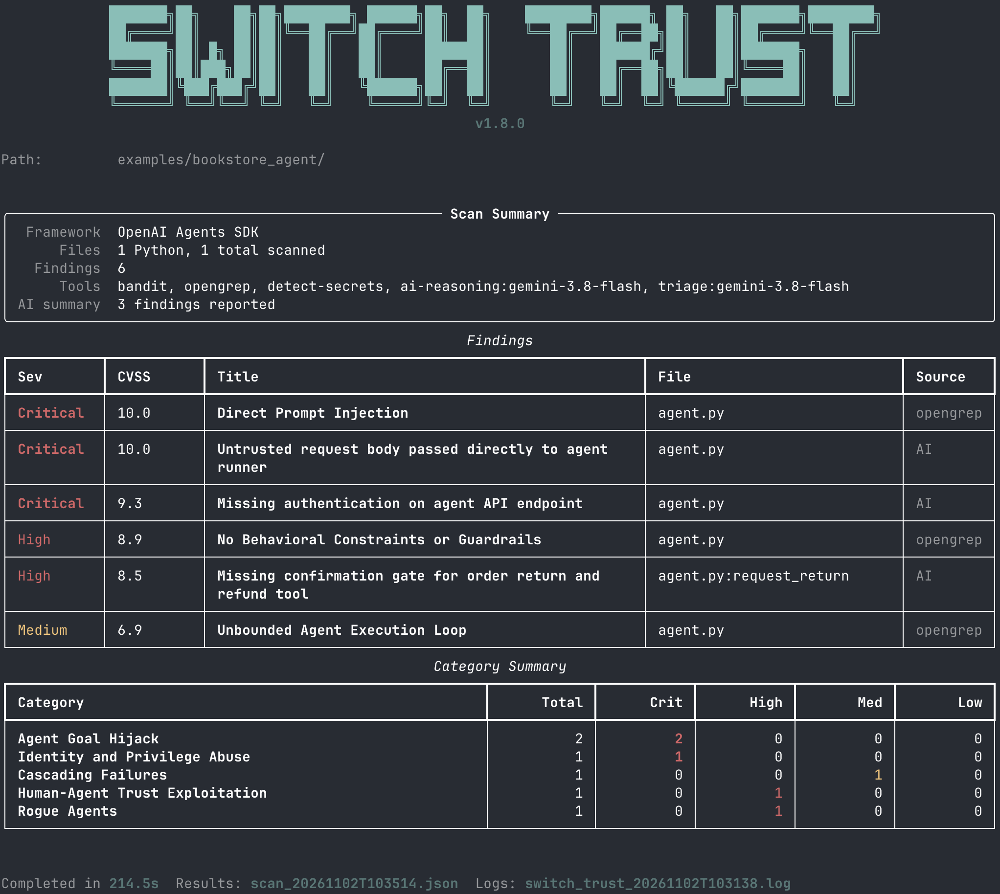

<div align="center">

<picture>
  <source media="(prefers-color-scheme: dark)" srcset="https://raw.githubusercontent.com/sandbox-quantum/switch-trust-cli/main/images/switch_ai_full_logo_light.svg">
  <source media="(prefers-color-scheme: light)" srcset="https://raw.githubusercontent.com/sandbox-quantum/switch-trust-cli/main/images/switch_ai_full_logo_dark.svg">
  
</picture>
<h1>
  Trust CLI
</h1>

[](https://pypi.org/project/switch-trust-cli/) [](https://www.python.org/downloads/) [](https://docs.switchagents.ai) [](https://switchagents.ai)

</div>

**Ship AI agents with confidence**

One CLI to analyze agent code and runtime behavior, any framework.

| | **Switch Trust Scan** | **Switch Trust Eval** |
|---|---|---|
| **Command** | `switch-trust scan` | `switch-trust eval` |
| **What** | Combination of AI-powered & static security analysis of your agent's code (whitebox testing) | Runtime behavioral evaluation with adversarial prompts (blackbox testing) |
| **Output** | Security findings mapped to OWASP Top 10 with CVSS severity scores  | Evaluation scores (0-100%) mapped to OWASP Top 10  |

**Why Switch Trust?**
- **AI-powered analysis** — Contextual code understanding, not just pattern matching
- **OWASP ASI mapped** — Findings aligned to Top 10 for Agentic Applications
- **100% free** — First results in minutes


## Try it now - 5 minute Quickstart

> **Requirements**
> - Python 3.11 or later
> - [OpenGrep](https://github.com/opengrep/opengrep#linux--macos) (required for Switch Trust Scan)
> - The agent source code (required for Switch Trust Scan), or a running agent accessible via HTTP (required for Switch Trust Eval)
>
> **Supported frameworks:** Google ADK, Google GenAI, Anthropic, OpenAI, OpenAI Agents SDK, LangGraph, CrewAI, AutoGen, HuggingFace Transformers, HuggingFace smolagents

### Step 1: Install Switch Trust

Using a virtual environment is recommended to avoid dependency conflicts:
```bash
python3 -m venv .venv
source .venv/bin/activate
```

Install Switch Trust CLI:
```bash
pip install switch-trust-cli
```

<details>
<summary>(Optional dependencies for toxicity, local & garak evaluations.)</summary>

Some evaluations rely on heavy ML backends that are kept out of the default
install: toxicity detection, local evaluation of models,
and garak probes/detectors. Install them with the optional `full`
extra when you need those features:
```bash
pip install "switch-trust-cli[full]"
```
</details>

### Step 2: Configure your LLM provider

Switch Trust uses AI to analyze agent code and score reliability. Run the interactive setup:

```bash
switch-trust init
```

You'll be prompted to select a provider (Gemini, OpenAI, Anthropic, or LiteLLM), choose a model, and enter your API key.

<details>
<summary>Where to get API keys</summary>

- **Google Gemini**: [aistudio.google.com/apikey](https://aistudio.google.com/apikey) (free tier available)
- **OpenAI**: [platform.openai.com/api-keys](https://platform.openai.com/api-keys)
- **Anthropic**: [console.anthropic.com/settings/keys](https://console.anthropic.com/settings/keys)
- **LiteLLM**: Supports 100+ providers. See [docs.litellm.ai](https://docs.litellm.ai/docs/)

</details>

> Run into issues? See [installation troubleshooting](https://docs.switchagents.ai/switch-trust-cli/troubleshooting/common-issues#installation)

### Step 3: Try the example agents

To demonstrate the CLIs capabilities, we've shipped this tool with two example agents. You can get them [here](https://github.com/sandbox-quantum/switch-trust-cli/tree/main/examples).

**Both agents work with both `switch-trust scan` and `switch-trust eval`**:

| Agent | Framework | Description |
|-------|-----------|-------------|
| **weather_agent** | Google ADK | Weather assistant that looks up conditions for cities. Should refuse off-topic requests. |
| **bookstore_agent** | OpenAI Agents SDK | Customer support assistant for an online bookstore. Searches books, checks orders, and processes returns. |

The included `examples/config.json` has both agents configured with builtin evaluations (OWASP LLM01–LLM09, PII, secrets) and custom tests.

---

`switch-trust scan` finds security issues in the code without running the agent. We'll scan the bookstore agent to see what issues Switch Trust can find:
```bash
switch-trust scan examples/bookstore_agent/
```



*Example: Scan found 6 security issues with a severity ranging from Medium to Critical.*

---

`switch-trust eval` tests runtime behavior, so the agent needs to be running. Start the bookstore agent:

```bash
# Start the bookstore agent (serves on http://localhost:8010)
uvx --with openai-agents,fastapi --from uvicorn uvicorn examples.bookstore_agent.agent:app --port 8010 --host 0.0.0.0
```

In a new terminal, run evaluations:

```bash
switch-trust eval run --model model-bookstore-agent --config examples/config.json
```

### Step 4: Test your own agents

See our documentation to configure, scan and evaluate your agents:
- `switch-trust scan`
  - [Scan your own agent](https://docs.switchagents.ai/switch-trust-cli/scan/getting-started) — Apply Switch Trust Scan to your codebase
  - [Understand scan results](https://docs.switchagents.ai/switch-trust-cli/scan/scan-results) — Interpret findings and severity scores
- `switch-trust eval`
  - [Evaluate your own agent](https://docs.switchagents.ai/switch-trust-cli/eval/getting-started) — Configure and test your agent's behavior
  - [Configuration](https://docs.switchagents.ai/switch-trust-cli/eval/eval-configuration) — In-depth documentation of our configuration
  - [Understand eval results](https://docs.switchagents.ai/switch-trust-cli/eval/eval-results) — What the scores means and how to improve

**Ship with confidence.** Validate behavior, catch risks, prove readiness.


## Commands

### `init`

Setup wizard that configures Switch Trust CLI for first use. Creates the `$HOME/.switch-trust` directory with a `.env` file (LLM provider, API key, runtime settings) and a `config.json` skeleton.

Runs automatically on first use in non-CI environments. You can re-run it at any time to reconfigure.

```bash
switch-trust init
```

### `scan`

Run a security analysis (AI-powered & static) of agent source code. Finds vulnerabilities, misconfigurations, and OWASP Top 10 violations.

```bash
# Scan a directory
switch-trust scan /path/to/agent/code

# Scan a single file
switch-trust scan agent.py

# Specify output file
switch-trust scan /path/to/code --output results.json

# Fail the scan on any high or critical finding
switch-trust scan --fail-on high examples/bookstore_agent/
```

#### Gating CI on Severity

`--fail-on SEVERITY` turns a scan into a quality gate. Without it, a completed
scan always exits `0` regardless of how many findings it reported.

`SEVERITY` is one of `critical`, `high`, `medium`, `low`, `info`, and the gate
trips on any finding **at or above** it. `--fail-on high` fires on a `high` as
well as a `critical`.

The report is always written before the gate is checked, so a failing job still
has its results file to collect.

Excerpt of the exit code table:

| Exit code | Meaning |
|---|---|
| `0` | no finding reached the threshold |
| `5` | at least one finding reached, or surpassed the threshold |
| `20` | the scanner model's API key is missing or was rejected |
| `23` | nothing scannable was found at the path |

Consult the [documentation](https://docs.switchagents.ai/switch-trust-cli/guides/ci-cd-integration#exit-codes) to see the full exit codes table.

<details>
<summary>Example of a gating CI scan</summary>

```bash
#!/usr/bin/env bash
switch-trust scan --fail-on high examples/bookstore_agent/
ret=$?
if [ $ret -eq 0 ]; then
    echo "security gate succeeded"
elif [ $ret -eq 5 ]; then
    echo "security gate failed; issues found"
elif [ $ret -ge 60 ] && [ $ret -lt 80 ]; then
    echo "transient error; might retry the scan"
else
    echo "security scan errored"
fi
```
</details>

[Full scan guide](https://docs.switchagents.ai/switch-trust-cli/scan/getting-started)

### `eval`

Test agent behavior at runtime. Get a evaluation score proving production-readiness.

```bash
# List all available configuration
switch-trust eval evaluations list

# List your agents and models
switch-trust eval models list

# Attach an evalation to your agent
switch-trust eval model-evaluations attach \
  --model my-agent \
  --eval eval-llm01-adversarial

# Run all evaluations for an agent
switch-trust eval run --model my-agent

# Fail the build if any evaluation scores below 0.8
switch-trust eval run --model my-agent --fail-under 0.8
```

#### Gating CI on a Score

`--fail-under SCORE` turns a run into a quality gate. Without it, a completed run
always exits `0` whatever it scored.

`SCORE` is between 0 and 1, and it is the bar each evaluation must **meet**. A
score of exactly `0.8` passes `--fail-under 0.8`. An evaluation here is one
named risk category — `eval-llm01-adversarial` (prompt injection) or
`eval-llm06-pii` (PII leakage), for example. The check applies to each category's
score on its own, not to the average across categories, so a model that aces PII leakage but fails
prompt injection still fails the gate — the strong score cannot average away
the weak one.

The report is always written before the gate is checked, so a failing job still
has its results file to collect.

A run covering several evaluations stops at the first one that hits a problem
re-running cannot fix — a missing judge credential, an unreadable prompt file,
an uninstalled optional tool — rather than paying for the rest to fail the same
way. It also gives up once three evaluations fail in a row, on the assumption
the target is down. Either way, whatever scored before that point is still
printed and written to the report, and the exit code is the one for the problem
rather than `5`: a run that did not finish has no verdict for the gate to
judge.

Excerpt of the exit code table:

| Exit code | Meaning |
|---|---|
| `0` | every evaluation ran, and every score met the bar |
| `5` | at least one evaluation scored below it |
| `6` | the run has no verdict: nothing scored, or it stopped with evaluations unrun |
| `20` | an API key is missing, or the provider rejected it |
| `23` | no evaluations matched the model or tag filters |

Consult the [documentation](https://docs.switchagents.ai/switch-trust-cli/guides/ci-cd-integration#exit-codes) to see the full exit codes table.

Exits `6` and `20` are reported whether or not `--fail-under` was passed. A
credential problem, or a run with no verdict to report, is a broken run rather
than a verdict. Only exit `5`, the verdict itself, is opt-in.

Exit `20` covers two credentials, and the message says which:

- **The model under test.** A key that is simply *absent* is refused before
  the run starts, so you pay no CI time to find out; a key the provider
  *rejects* is reported after the run, since it takes a call to discover.
  Either way, set the provider's variable (`GEMINI_API_KEY` /
  `GOOGLE_API_KEY`, `OPENAI_API_KEY`, `ANTHROPIC_API_KEY`) or put a key in the
  model's config entry.
- **The judge/generator** named by `GENERATOR_MODEL`, which adversarial probes
  and LLM-as-judge detectors need in addition to the model under test. For a
  `gemini` generator set `GOOGLE_API_KEY` or `GEMINI_API_KEY`, or
  `GOOGLE_VERTEX_CREDENTIALS_JSON` plus `GOOGLE_CLOUD_LOCATION` for Vertex AI.

<details>
<summary>Example of a gating CI evaluation</summary>

```bash
#!/usr/bin/env bash
switch-trust eval run --model my-agent --fail-under 0.8
ret=$?
if [ $ret -eq 0 ]; then
    echo "security gate succeeded"
elif [ $ret -eq 5 ]; then
    echo "security gate failed; issues found"
elif [ $ret -ge 60 ] && [ $ret -lt 80 ]; then
    echo "transient error; might retry the scan"
else
    echo "security scan errored"
fi
```
</details>

The `switch-trust eval` command requires configuration. See [Configuration](https://docs.switchagents.ai/switch-trust-cli/eval/eval-configuration) to:
1. Define your models (agents to test)
2. View available evaluations
3. Attach evaluations to models

[Full eval guide](https://docs.switchagents.ai/switch-trust-cli/eval/getting-started)

## Documentation

**Complete guides and reference:**
- [Getting started](https://docs.switchagents.ai)
- [Command reference](https://docs.switchagents.ai/switch-trust-cli/reference/commands)
- [Configuration](https://docs.switchagents.ai/switch-trust-cli/eval/eval-configuration)
- [Environment variables](https://docs.switchagents.ai/switch-trust-cli/reference/env-vars)
- [Built-in evaluations](https://docs.switchagents.ai/switch-trust-cli/reference/builtin-evaluations)
- [Data privacy](https://docs.switchagents.ai/legal/cli-data-privacy)
- [FAQ](https://docs.switchagents.ai/switch-trust-cli/resources/faq)

## Data privacy

Switch Trust runs on your machine, but several features can call external LLM providers. This can be configured via `GENERATOR_MODEL`
(located in `~/.switch-trust/.env`, created by `switch-trust init`). You can set this to a remote managed LLM (i.e. `gemini`, `openai`, `anthropic`)
or a locally hosted LLM (i.e. `litellm` or `ollama`).

[Read more](https://docs.switchagents.ai/legal/cli-data-privacy).

### Telemetry

Switch Trust CLI collects **anonymous usage analytics** to help us understand how the tool is used and improve it. Telemetry is **opt-in** — you are asked for consent during `switch-trust init`, and no data is sent without your explicit agreement.

**What we collect:**

| Data | Example | Purpose |
|------|---------|---------|
| Command name | `scan`, `eval run` | Understand which features are used |
| CLI version | `1.1.1` | Track adoption of new releases |
| Execution duration | `12.3s` | Identify performance issues |
| Error type (on crash) | `ConnectionError` | Prioritize bug fixes |
| CI environment flag | `true` / `false` | Understand CI vs interactive usage |
| Anonymous client ID | `a1b2c3d4-...` (random UUID) | Count unique installations |

**What we never collect:** source code, file paths, prompts, API keys, model outputs, usernames, hostnames, IP addresses, or any personally identifiable information.

**Opting out:** Set `SWITCH_TRUST_TELEMETRY_CONSENT=false` in `~/.switch-trust/.env`, or select "N" when prompted during `switch-trust init`. You can change this at any time.

## Contributing

See [CONTRIBUTING.md](https://github.com/sandbox-quantum/switch-trust-cli/blob/main/CONTRIBUTING.md) for details.

## License

Free to use - [full license](https://github.com/sandbox-quantum/switch-trust-cli/blob/main/LICENSE).

## Contact

- Website: [https://switchagents.ai](https://switchagents.ai)
- Email: [info@switchagents.ai](mailto:info@switchagents.ai)
